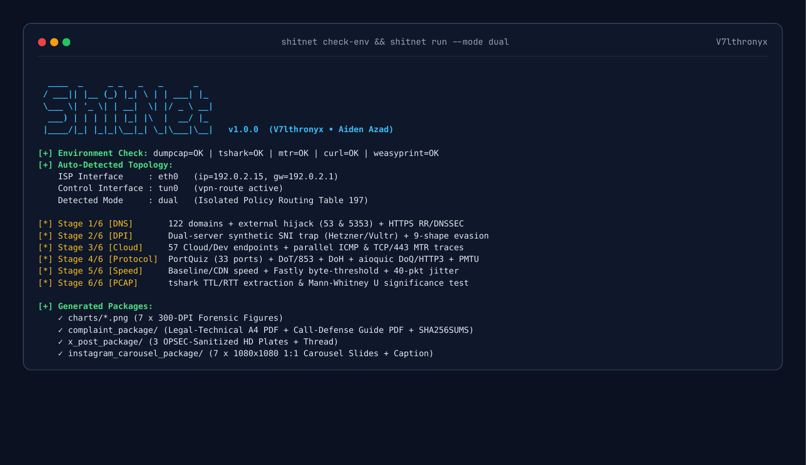
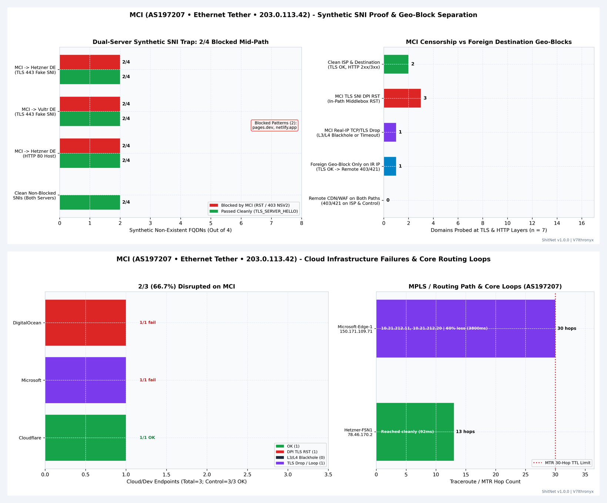
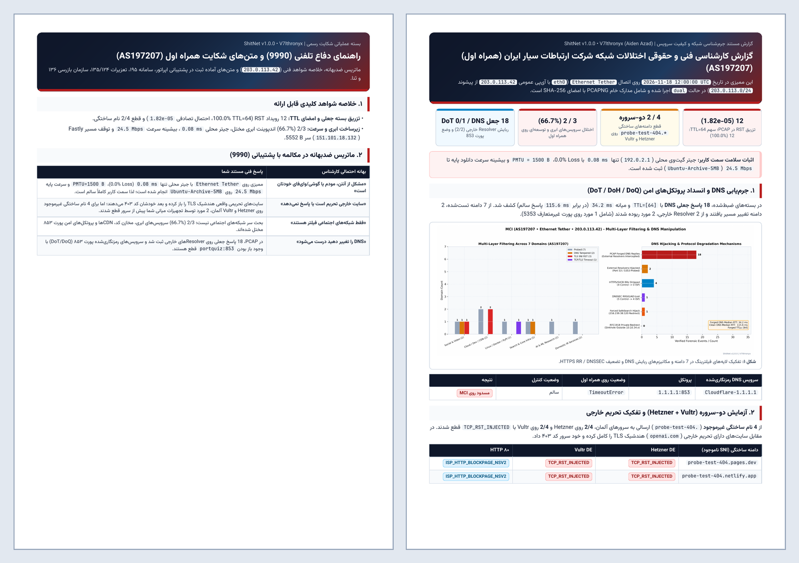
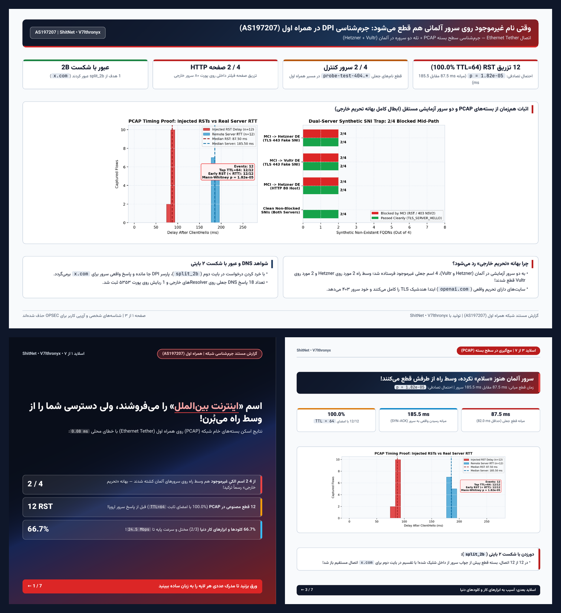

# ShitNet

**Automated ISP Censorship Forensics, Deep Packet Inspection Proof & Legal Evidence Suite**

Developed by **Aiden Azad** — **[V7lthronyx](https://github.com/v7lthronyx1)**

[نسخه فارسی راهنما (README_FA.md)](README_FA.md)

---

## Overview

**ShitNet** (`shitnet`) is a self-contained Linux network forensics and Quality-of-Service auditing CLI built to isolate, prove, and document packet-level interference on any consumer or mobile ISP connection (tested across Iranian cellular & broadband providers such as **MCI AS197207**, **Irancell AS44244**, **RighTel AS57218**, **TCI AS58224**, **Shatel AS31549**, **Asiatech AS43754**, **HiWEB AS56402**, and **MobinNet AS50810**).

Instead of relying on subjective speedtests, `shitnet` captures live packets with `dumpcap`, analyzes them with `tshark` and non-parametric statistics (`scipy`), separates upstream destination geo-blocks (`HTTP 403/421` after full `TLS_SERVER_HELLO`) from mid-path operator injection, and generates ready-to-file regulatory complaint PDFs, cryptographically hashed PCAP evidence bundles (`SHA-256`), and OPSEC-sanitized visual summaries for X and Instagram (`1:1`).

---

## Visual Preview

### CLI & 6-Stage Pipeline


### Forensic Diagnostic Charts (`300 DPI`)


### Automated Regulatory Complaint PDFs (Persian RTL + SHA-256)


### OPSEC-Sanitized Social Cards (X HD Plates & `1:1` Instagram Carousel)


---

## Key Capabilities

- **Zero-Config Topology & ASN Auto-Detection**: Automatically identifies active network interfaces, local gateways, DNS resolvers, public exit IPs, prefixes, and operator ASNs/support channels.
- **3 Flexible Audit Modes**:
  - `dual`: Probes direct ISP and an isolated control VPN interface simultaneously (with automatic temporary Linux policy routing cleanup).
  - `two-phase`: Guided single-connection workflow — runs all direct ISP probes first, pauses while you enable a clean VPN/line, then captures control baselines and generates full differential verdicts.
  - `direct-only`: Standalone forensic mode requiring no VPN (proves synthetic SNI interception, PCAP `RST TTL`/timing violations, `split_2b` DPI bypasses, DNS RFC1918/sinkhole forgery, internal `MTR` routing loops, and local gateway jitter stability).
- **6-Stage Forensic Engine**:
  1. **DNS Manipulation**: Probes 122+ domains across 9 categories, tests external resolvers across UDP/TCP port `53` and non-standard port `5353`, tracks `HTTPS/SVCB` stripping, `DNSSEC` degradation, and `RFC1918` / SafeSearch hijacking.
  2. **DPI & Dual-Server Synthetic SNI Trap**: Sends 20 non-existent FQDNs (`probe-test-404.*`) directly to independent control servers (Hetzner DE & Vultr DE) alongside a 9-shape `ClientHello` evasion matrix (`normal`, `tls12`, `pad1800`, `ech_grease`, `split_5b`, `split_midsni`, `split_2b`, `rec_split_2`, `rec_split_5`).
  3. **Cloud Infrastructure & Core MTR Loops**: Probes 57 public cloud, CDN, PaaS, and package registry endpoints plus parallel ICMP & TCP/443 `mtr` traces to expose internal core routing loops.
  4. **Encrypted DNS & Protocol Audit**: Benchmarks `PortQuiz` across 33 TCP ports (including `25` and `853`) vs `DoT (TCP/853)`, `DoH`, `QUIC/HTTP3`, `DoQ (UDP/853)` via `aioquic`, `NTP`, `STUN`, and `PMTU`.
  5. **Selective Throughput & Edge Thresholds**: Compares baseline download rates across domestic/global mirrors, probes Fastly byte-stall boundaries, and runs 40-packet burst latency/jitter sweeps.
  6. **PCAP Statistical Verification**: Runs `tshark` timing & TTL extraction comparing real server `SYN-ACK RTT` against injected `TCP RST` arrival latency (`Mann-Whitney U` one-sided p-value).
- **Automated Reporting & Packaging**:
  - 7 high-DPI diagnostic charts (`charts/`)
  - Bilingual `REPORT_FA.md` & `REPORT_EN.md`
  - Print-ready A4 Persian Legal-Technical Report PDF & Call-Defense Complaint Guide PDF (`complaint_package/`) tailored to the detected ISP
  - Full `SHA256SUMS.txt` + `PACKAGE_SHA256SUMS.txt` manifests
  - Optional OPSEC-scanned X HD plates (`2126x1252`), thread drafts, and `1080x1080` (`1:1`) Instagram carousel slides (`x_post_package/`, `instagram_carousel_package/`) with EXIF stripped and personal IPs banned.

---

## Installation (Debian / Kali / Ubuntu / Arch / Fedora)

```bash
git clone https://github.com/v7lthronyx1/shitnet.git
cd shitnet
./setup.sh
```

Grant non-root packet capture permissions once (or run audits with `sudo`):

```bash
sudo setcap cap_net_raw,cap_net_admin=eip $(which dumpcap)
```

Verify environment and detected interfaces:

```bash
.venv/bin/shitnet check-env
```

---

## Usage

### Interactive Guided Wizard (Recommended)

```bash
.venv/bin/shitnet wizard
```

### Automated Single-Command Run

```bash
sudo .venv/bin/shitnet run --mode two-phase --conn-type "USB Tether"
```

### Compare Multiple Sessions (Track Progression Across Audits)

```bash
.venv/bin/shitnet run --mode dual --compare ./audits/session_1 ./audits/session_2
```

### Re-render Reports, PDFs & Social Packages from Existing Captures

```bash
.venv/bin/shitnet render ./audits/audit_20261118_120000Z_eth0 --compare ./audits/session_1
```

### Verify SHA-256 Integrity & OPSEC Safety

```bash
.venv/bin/shitnet verify ./audits/audit_20261118_120000Z_eth0
```

---

## Offline Self-Test

```bash
.venv/bin/python -m unittest discover -s tests -v
```

---

## Legal & OPSEC Notice

- Public social outputs (`x_post_package/` and `instagram_carousel_package/`) automatically strip PNG metadata and enforce OPSEC checks blocking local LAN/gateway IPs, public subscriber IPs, OS usernames, hostnames, and any `--opsec-ban` strings.
- `complaint_package/` intentionally retains your ISP public IP, ASN prefix, and `PCAPNG` captures strictly for formal technical filing with your ISP NOC, CRA `195`, or consumer protection authorities (`124` / `135`). Never upload raw PCAP files or `complaint_package/` PDFs publicly if you wish to keep session IPs private.
- Designed strictly for legitimate defensive network diagnostics, QoS verification, and consumer rights documentation.

---

## License

MIT License — Copyright (c) 2026 **Aiden Azad (V7lthronyx)**
