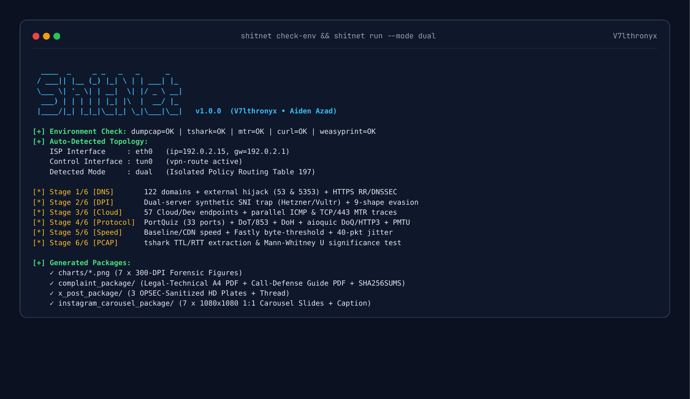
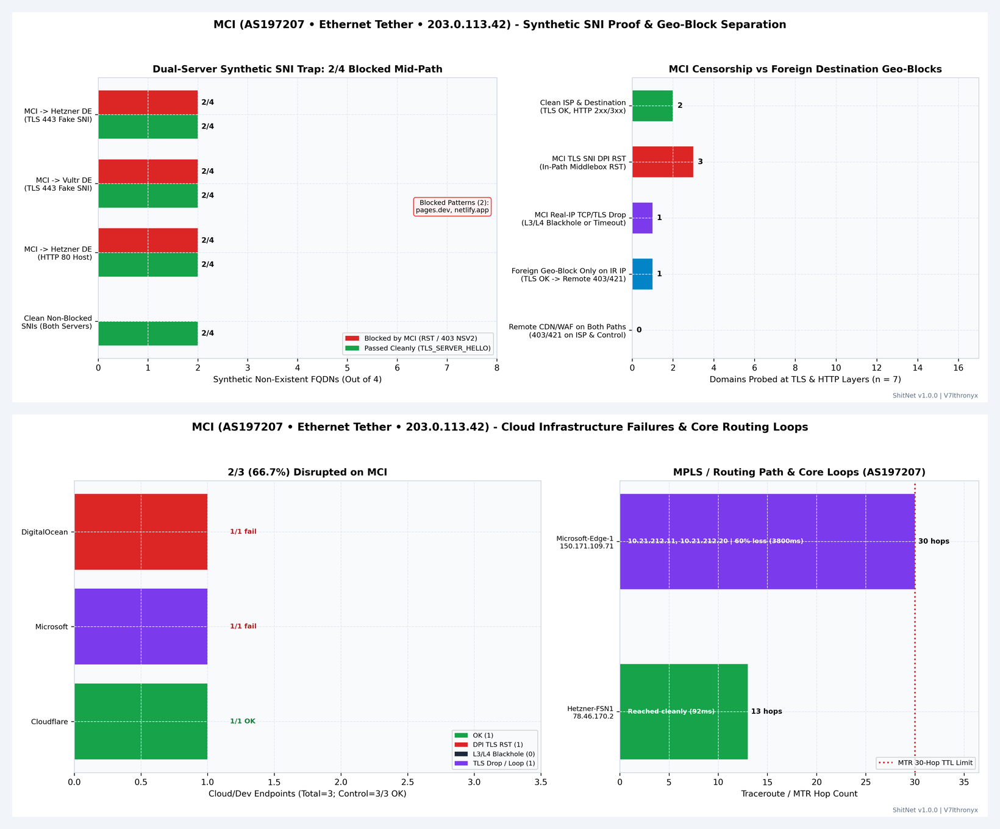
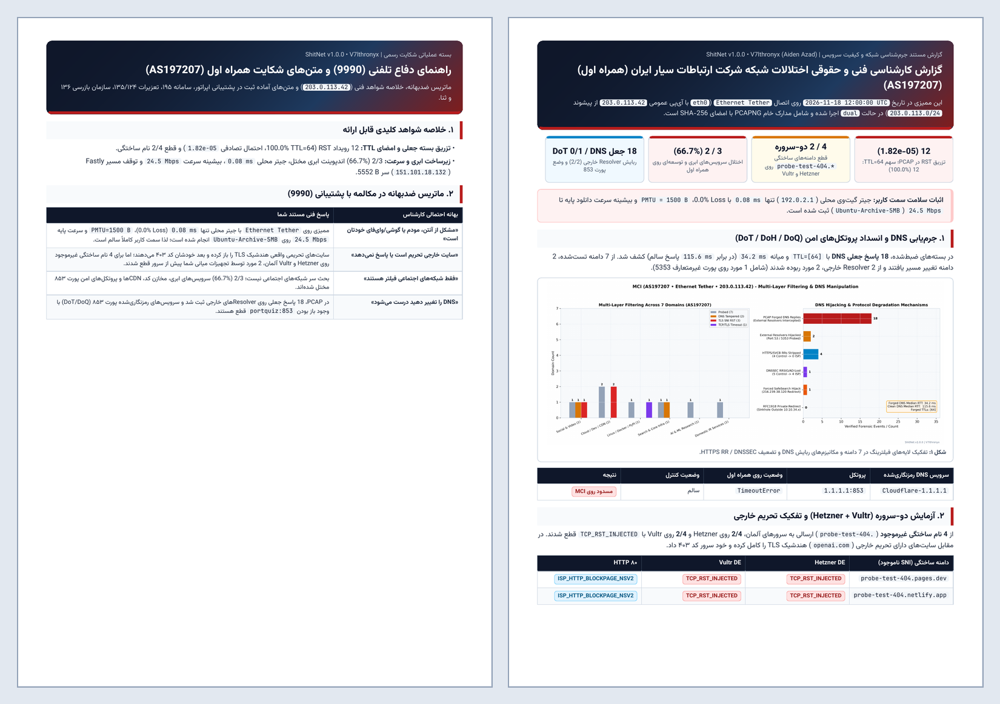
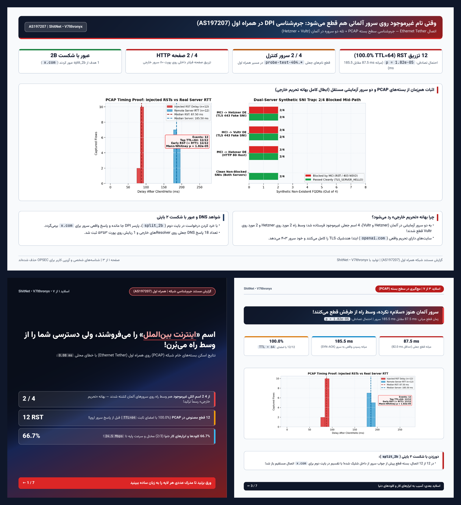

# ShitNet (شیت‌نت)

**ابزار خودکار جرم‌یابی شبکه، اثبات DPI، سنجش کیفیت اینترنت و تولید پکیج کامل شکایت**

ساخته‌شده توسط **Aiden Azad** — برند **[V7lthronyx](https://github.com/v7lthronyx1)**

[English Documentation (README.md)](README.md)

---

## معرفی

**ShitNet** یک ابزار متن‌باز و تمام‌خودکار تحت لینوکس (تست‌شده روی کالی، دبیان و اوبونتو) است که هر کاربر روی **هر اپراتور اینترنتی** (همراه اول `AS197207`، ایرانسل `AS44244`، رایتل `AS57218`، مخابرات `AS58224`، شاتل `AS31549`، آسیاتک `AS43754`، های‌وب `AS56402`، مبین‌نت `AS50810` و...) می‌تواند با اجرای آن، تمام اختلالات و فیلترینگ‌های غیرمتعارف شبکه خود را در سطح بسته (`PCAPNG`) ثبت و مستندسازی کند.

این ابزار برخلاف تست‌های ساده سرعت، دقیقاً ثابت می‌کند:
1. آیا مشکل از آنتن/گوشی/مودم کاربر است یا هسته اپراتور (با سنجش جیتر گیت‌وی محلی و `PMTU`).
2. آیا خطا ناشی از تحریم سایت خارجی (`HTTP 403` پس از `TLS_SERVER_HELLO`) است یا تزریق بسته جعلی وسط راه ایران (آزمایش ۲۰ نام جعلی غیرموجود `probe-test-404.*` روی دو سرور مستقل آلمان `Hetzner` و `Vultr`).
3. بسته‌های قطع جعلی `TCP RST` با چه `TTL` ثابت و با چه سرعتی پیش از جواب واقعی سرور شلیک می‌شوند (آزمون آماری `Mann-Whitney U`).
4. چند درصد سرویس‌های مجاز ابری و توسعه (کلودها، داکر، دبیان، پایتون، گیت‌هاب، PaaS) مختل‌اند و مسیرها در کدام روتر داخلی حلقه (`MTR Hop 30`) دارند.
5. وضعیت جعل `DNS` (پورت `53` و `5353`) و انسداد پروتکل‌های رمزنگاری‌شده پورت `853` (`DoT`، `DoH`، `DoQ`) با وجود باز بودن پورت کنترل `PortQuiz`.

---

## پیش‌نمایش محیط ابزار و خروجی‌ها

### محیط خط فرمان (CLI) و موتور ۶ مرحله‌ای


### نمودارهای جرم‌شناسی فنی (`300 DPI`)


### فایل‌های PDF گزارش فنی-حقوقی و راهنمای شکایت اپراتور


### خروجی‌های سانسورشده (OPSEC-Safe) برای X و اینستاگرام (`1:1`)


---

## ۳ حالت اجرای خودکار

1. **`dual` (دو اتصال هم‌زمان)**: وقتی هم اینترنت اپراتور (`eth0` / `wlan0` / `usb0`) و هم VPN کنترل (`tun0` / `wg0`) هم‌زمان وصل هستند؛ ابزار به‌صورت ایزوله با جدول مسیریابی موقت مقایسه را هم‌زمان انجام می‌دهد و در پایان تنظیمات مسیر را به حالت اول برمی‌گرداند.
2. **`two-phase` (تک‌خط دومرحله‌ای — مناسب برای اکثر کاربران)**: بدون نیاز به تنظیم دستی مسیر؛ ابتدا تست مستقیم اپراتور را انجام می‌دهد، سپس مکث می‌کند تا VPN یا اینترنت سالم را وصل کنید و کلید Enter را بزنید تا مقایسه کامل ساخته شود.
3. **`direct-only` (بدون نیاز به VPN)**: تست مستقیم روی خط اپراتور برای اثبات تزریق `RST` در `PCAP`، تله `SNI` ساختگی روی آلمان، شکست ۲ بایتی (`split_2b`)، ربایش `DNS RFC1918` و حلقه‌های داخلی `MTR`.

---

## نصب سریع

```bash
git clone https://github.com/v7lthronyx1/shitnet.git
cd shitnet
./setup.sh
```

اعطای دسترسی کپچر به `dumpcap` (یا اجرا با `sudo`):

```bash
sudo setcap cap_net_raw,cap_net_admin=eip $(which dumpcap)
```

بررسی ابزارهای سیستم و اینترفیس‌های شبکه:

```bash
.venv/bin/shitnet check-env
```

---

## نحوه اجرا

### اجرای ویزارد تعاملی (پیشنهادی برای همه)

```bash
.venv/bin/shitnet wizard
```

### اجرای خودکار تک‌دستوری

```bash
sudo .venv/bin/shitnet run --mode two-phase --conn-type "Wi-Fi"
```

### مقایسه با تست‌های قبلی (ثبت تداوم یا بدتر شدن وضعیت)

```bash
.venv/bin/shitnet run --mode two-phase --compare ./audits/session_old_1 ./audits/session_old_2
```

### ممیزی کارت شبکه اپراتور از پشت VPN فعال (بدون تغییر جدول مسیر)

```bash
.venv/bin/shitnet run --mode dual --iface eth0 --control-dns 127.0.2.1 --no-auto-route --conn-type "Ethernet / USB Tether"
```

### تولید مجدد گزارش، PDF و اسلایدهای شبکه اجتماعی از روی داده‌های موجود

```bash
.venv/bin/shitnet render ./audits/audit_20261118_120000Z_wlan0
```

---

## خروجی‌های تولیدشده در پوشه ممیزی

- `charts/` — ۷ نمودار فنی با کیفیت ۳۰۰ DPI
- `raw_data/` و `raw_pcaps/` — تمام داده‌های خام JSON/CSV و فایل‌های کپچر `PCAPNG`
- `REPORT_FA.md` و `REPORT_EN.md` — گزارش‌های جامع فنی فارسی و انگلیسی
- `SHA256SUMS.txt` و `EVIDENCE_MANIFEST.json` — گواهی اصالت دیجیتال تمام مدارک
- `complaint_package/`:
  - فایل PDF **گزارش فنی-حقوقی** اختصاصی با نام و شناسه اپراتور شما (آماده پیوست در سامانه **۱۹۵ رگولاتوری**)
  - فایل PDF **راهنمای دفاع تلفنی (`۹۹۹۰` / `۷۰۰` / `۲۰۰` / `۲۰۲۰` / `۱۵۴۴`) + متن‌های کپی-پیست**
  - فایل متنی `01_متن_آماده_ثبت_شکایت.txt` (پشتیبانی اپراتور، ۱۹۵، تعزیرات ۱۲۴/۱۳۵، دیوان عدالت و ۱۳۶)
  - پوشه آینه `evidence/` همراه با `PACKAGE_SHA256SUMS.txt`
- `x_post_package/` — ۳ تصویر اینفوگرافیک HD مخصوص **ایکس (X)** + پست بلند + رشته توییت ۶تایی
- `instagram_carousel_package/` — ۷ اسلاید مربع دقیق **۱:۱ (`1080x1080`)** با اسلاید اول هوک‌دار + کپشن + هشتگ + متن استوری

---

## نکات امنیتی (OPSEC)

- بسته‌های انتشار عمومی (`x_post_package/` و `instagram_carousel_package/`) به‌طور خودکار توسط ابزار از هرگونه **آی‌پی عمومی مشترک، آی‌پی شبکه خانگی/گیت‌وی، نام کاربری سیستم، نام میزبان و متادیتای PNG** پاک‌سازی و اسکن می‌شوند. همچنین می‌توانید با گزینه `--opsec-ban نام_شهر مدل_گوشی` کلمات اضافه را هم مسدود کنید.
- پوشه `complaint_package/` برای ارائه رسمی به اپراتور یا سامانه ۱۹۵ حاوی آی‌پی ممیزی و فایل‌های `PCAPNG` است؛ این پوشه را در شبکه‌های اجتماعی عمومی منتشر نکنید.

---

## مجوز انتشار

منتشرشده تحت لایسنس **MIT** — **Aiden Azad (V7lthronyx)**
